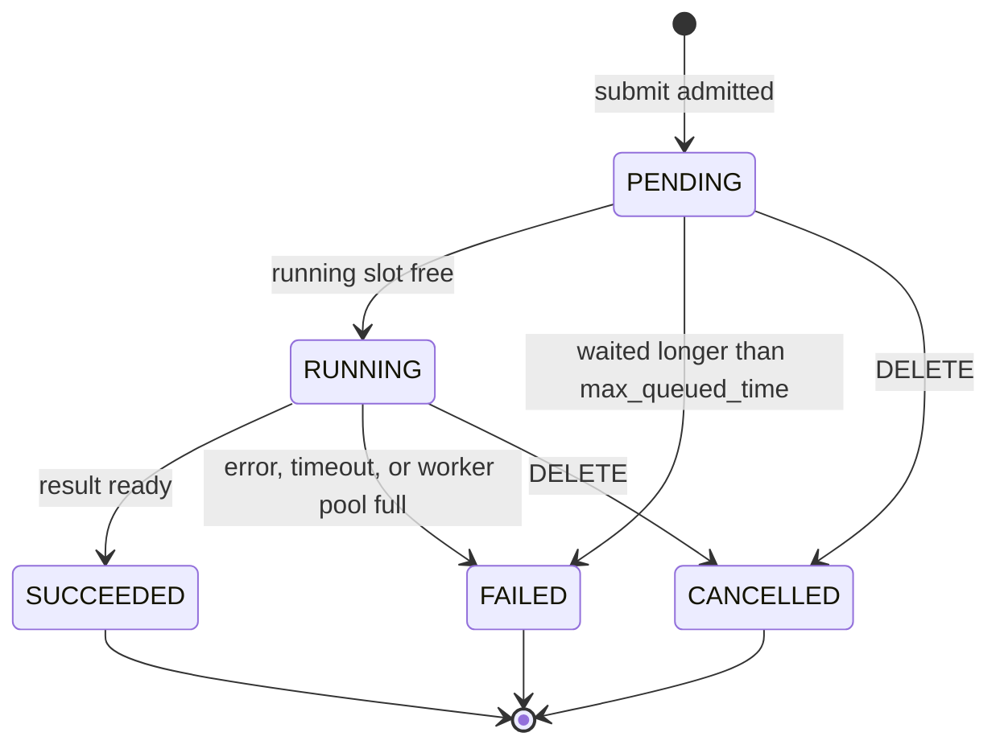
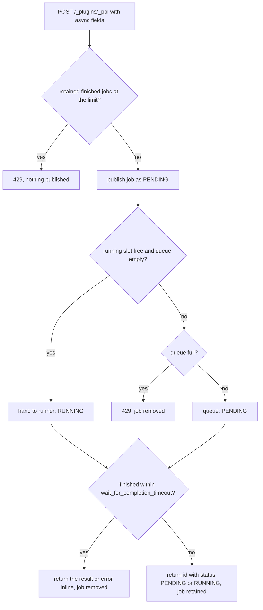

# PPL Async Query Lifecycle

This page explains the states of an async PPL query and how it moves between them. It is for developers changing the async code; the user-facing API is documented in [endpoint.md](../user/ppl/interfaces/endpoint.md).

## Components

| Class | Module | Role |
|---|---|---|
| `TransportPPLQueryAction` | plugin | Builds the runner and calls the job service for a submit that carries `wait_for_completion_timeout` or `keep_alive` |
| `PPLQueryRunner` | ppl | Runs one PPL query |
| `OpenSearchQueryJobService` | opensearch | Submit, GET, and DELETE |
| `AccountingQueryJobStore` | opensearch | Holds jobs; counts finished retained jobs and rejects a submit when they reach the limit |
| `OpenSearchQueryJobScheduler` | opensearch | Running slots, the queue, and the wait deadline; starts a queued job in its submitter's context |
| `RetentionPolicy` | opensearch | Removes a finished job `keep_alive` after it finishes |
| `QueryJob` | core | The state machine of one query |

## Job states

A job has one of five states (`QueryJobState`). `PENDING` means accepted and waiting in the queue for a running slot. `RUNNING` means handed to its runner: being parsed, planned, or executed. `SUCCEEDED`, `FAILED`, and `CANCELLED` are terminal.

Two rules hold for every job:

- It never returns to an earlier state.
- A terminal state never changes.

| From | To | Trigger | Code |
|---|---|---|---|
| — | `PENDING` | Submit passes the admission checks and is published to the store | `OpenSearchQueryJobService.submit` |
| `PENDING` | `RUNNING` | A running slot is free: at submit, or when a running job finishes | `OpenSearchQueryJobScheduler`, `QueryJob.startRunner` |
| `PENDING` | `FAILED` | The job waited in the queue longer than `max_queued_time` | `OpenSearchQueryJobScheduler`, `QueryJob.failQueued` |
| `PENDING` / `RUNNING` | `CANCELLED` | DELETE | `OpenSearchQueryJobService.delete`, `QueryJob.cancel` |
| `RUNNING` | `SUCCEEDED` | The runner returned a result | `QueryJob.onRunnerSuccess` |
| `RUNNING` | `FAILED` | Parsing, planning, or execution failed or timed out, or `sql-worker` or `sql-complex-worker` refused the query (`WorkerPoolSaturatedException`) | `QueryJob.onRunnerFailure` |

When the submit wait expires, the job is reported by its state at that moment, `PENDING` or `RUNNING`. A job that finished at that moment is reported inline instead.

## Submit

A job that finishes inside the submit wait is never retained and never counted. This includes a query that a full worker pool refused; the client gets `429`. A job whose id is returned is retained: it is counted once it finishes and kept for polling.

## Store lifecycle

A job is in the store from publish until removal. Removal happens in exactly one place, `AccountingQueryJobStore.remove`, which also releases its count.

| Event | Removed by | What is released |
|---|---|---|
| Finished inside the submit wait | `OpenSearchQueryJobService.submit` | Nothing was counted |
| Queue full at submit | `OpenSearchQueryJobService.submit` | Nothing was counted |
| DELETE | `OpenSearchQueryJobService.delete` (then the job is cancelled) | Finished count, if counted |
| `keep_alive` after it finished | `RetentionPolicy` | Finished count |
| Store closed | `AccountingQueryJobStore.close` | Everything |

A retained job counts toward `max_retained_jobs` from when it finishes, and only if it is still in the store; a job deleted while it runs is never counted.

## Scheduler

The scheduler works like a thread pool executor with a bounded work queue. A job does not hold a thread while it runs; the work runs on the SQL worker pools.

- **Running slots.** At most `node_concurrent_running_queries` jobs are `RUNNING`.
- **Queue.** Up to `max_queued_queries` jobs wait as `PENDING`, in submission order. A submit beyond that gets `429`.
- **Submitter context.** A queued job starts on whichever thread frees a slot. The scheduler captures the submitting thread's context when it queues the job and restores it when the job starts: the OpenSearch thread context (security user, headers, trace span), the logging context, and the query task that cancellation reaches.
- **Wait deadline.** A queued job may wait for `max_queued_time`. When it runs out, the job ends `FAILED`. The deadline is cancelled when the job starts.
- **Worker pools.** A running slot only bounds async jobs. It does not reserve room in the SQL worker pools, which sync queries and other features share. A job that a full pool refuses ends `FAILED`; it is not retried. Admitting every query through one scheduler is tracked in [#5912](https://github.com/opensearch-project/sql/issues/5912).

## Timers

| Timer | Pool | Armed | Effect |
|---|---|---|---|
| Wait deadline | `generic` | When the job is queued | Fails the job if it is still queued |
| Retention | `generic` | When a retained job finishes | Removes the job after `keep_alive` |
| Query timeout | `generic` | When the query runs on a worker | Interrupts the worker after `plugins.ppl.query.timeout` |

## GET and DELETE by state

| State | GET | DELETE |
|---|---|---|
| `PENDING` | `200`, `status: PENDING`, no rows | `200`, `status: CANCELLED`; the job is removed |
| `RUNNING` | `200`, `status: RUNNING`, no rows | `200`, `status: CANCELLED`; execution is cancelled and the job removed |
| `SUCCEEDED` | `200`, the rows | `200`, `status: SUCCEEDED`; the job is removed |
| `FAILED` | `200`, the error | `200`, `status: FAILED`; the job is removed |
| Removed or unknown | `404` | `404` |

## Settings

| Setting | Default | Enforced by |
|---|---|---|
| `plugins.ppl.async.node_concurrent_running_queries` | `20` | Scheduler |
| `plugins.ppl.async.max_queued_queries` | `100` | Scheduler |
| `plugins.ppl.async.max_queued_time` | `5m` | Scheduler |
| `plugins.ppl.async.max_retained_jobs` | `100` | `AccountingQueryJobStore` |

All settings are dynamic and read on every decision. A lowered limit applies to the next submit; jobs already admitted are not evicted.

## Thread safety

- `QueryJob` guards its state with its own monitor and never takes the scheduler's or the store's lock while holding it.
- The scheduler and the store each have one lock. Locks are always taken in the order store or scheduler, then job.
- Jobs are started, failed, and cancelled after the scheduler lock is released. A job refused synchronously on start fails and frees its slot, which calls back into the scheduler; `drain` does not nest on the same thread.
