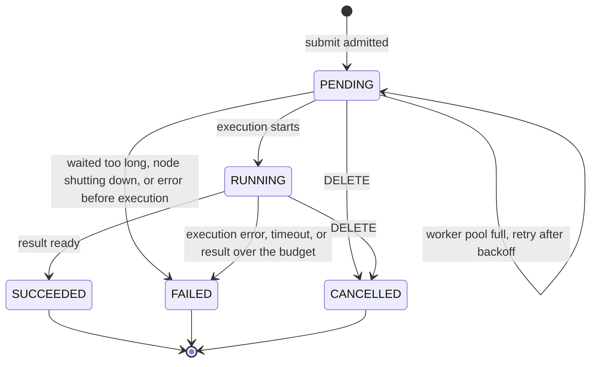
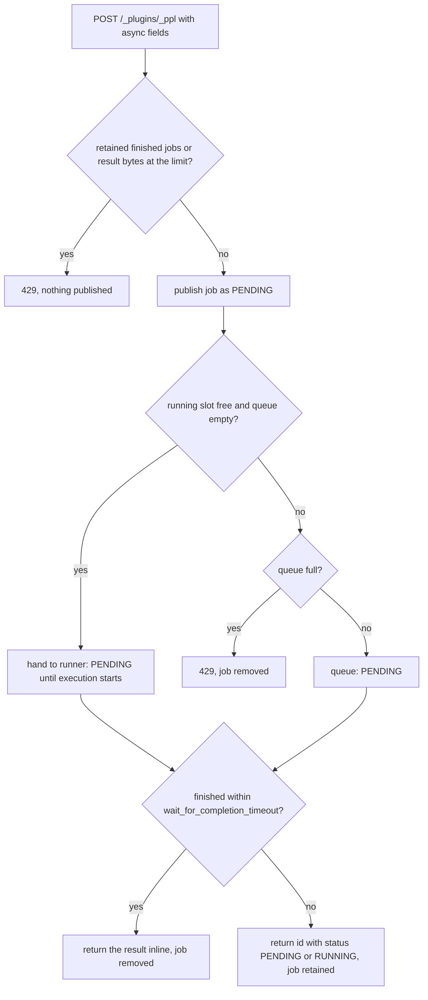

# PPL Async Query Lifecycle

This page explains the states of an async PPL query and how it moves between them. It is for developers changing the async code; the user-facing API is documented in [endpoint.md](../user/ppl/interfaces/endpoint.md).

## Components

| Class | Module | Role |
|---|---|---|
| `TransportPPLQueryAction` | plugin | Builds the runner and calls the job service for a submit that carries `wait_for_completion_timeout` or `keep_alive` |
| `ContextPreservingQueryRunner` | plugin | Restores the submitter's thread context, logging context, and PPL task when a queued query starts on another thread |
| `PPLQueryRunner` | ppl | Runs one PPL query; `newAttempt()` makes a fresh runner for a retry |
| `OpenSearchQueryJobService` | opensearch | Submit, GET, and DELETE |
| `AccountingQueryJobStore` | opensearch | Holds jobs; counts finished retained jobs; checks the retained limits on submit; releases them on removal |
| `QueryJobQuota` | opensearch | Checks the retained limits; tracks retained result bytes |
| `OpenSearchQueryJobScheduler` | opensearch | Running slots, the queue, backoff after a refusal, and the wait deadline |
| `RetentionPolicy` | opensearch | Removes a finished job `keep_alive` after it finishes |
| `QueryJob` | core | The state machine of one query |

## Job states

A job has one of five states (`QueryJobState`). `PENDING` means accepted but not yet executing: waiting in the queue, backing off after a worker pool refused it, or being prepared (parsed and planned) on a worker. `RUNNING` means executing. `SUCCEEDED`, `FAILED`, and `CANCELLED` are terminal.

Two rules hold for every job:

- It never returns to an earlier state. In particular, a refused job stays `PENDING`; it never goes from `RUNNING` back to `PENDING`.
- A terminal state never changes.

| From | To | Trigger | Code |
|---|---|---|---|
| — | `PENDING` | Submit passes the admission checks and is published to the store | `OpenSearchQueryJobService.submit` |
| `PENDING` | `PENDING` | `sql-worker` or `sql-complex-worker` refused the query (`WorkerPoolSaturatedException`) before it executed; the job gets a fresh runner and backs off | `QueryJob.onRunnerFailure`, `OpenSearchQueryJobScheduler.requeue` |
| `PENDING` | `RUNNING` | The engine begins executing the query, on the worker that runs it | `OpenSearchExecutionEngine` → `PPLQueryTask.onExecutionStarted` → `QueryJob.onExecutionStarted` |
| `PENDING` | `FAILED` | The total wait passed `max_queued_time`; the pool refused because the node is shutting down; the retry could not be scheduled; or the query failed while being prepared (parse, plan) | `OpenSearchQueryJobScheduler`, `QueryJob.failQueued`, `QueryJob.onRunnerFailure` |
| `PENDING` / `RUNNING` | `CANCELLED` | DELETE | `OpenSearchQueryJobService.delete`, `QueryJob.cancel` |
| `RUNNING` | `SUCCEEDED` | The runner returned a result, and it fits the budget if retained | `QueryJob.onRunnerSuccess` |
| `RUNNING` | `FAILED` | Execution failed or timed out, or a retained result does not fit the budget | `QueryJob.onRunnerFailure`, `QueryJob.chargeOrFail` |

A job is handed to its runner while still `PENDING`. It becomes `RUNNING` only when the engine reports that execution began; a runner that cannot report this counts as starting at once. A result that arrives without a start report counts as starting and finishing together.

When the submit wait expires, the job is checked and, if unfinished, marked retained in one step. A job that just finished is reported inline instead, so a finished result is never retained after the fact.

## Submit

A job that finishes inside the submit wait is never retained and never counted. A job whose id is returned is retained: it is counted once it finishes and kept for polling.

## Store lifecycle

A job is in the store from publish until removal. Removal happens in exactly one place, `AccountingQueryJobStore.remove`, which also releases what the job counted.

| Event | Removed by | What is released |
|---|---|---|
| Finished inside the submit wait | `OpenSearchQueryJobService.submit` | Nothing was counted |
| Queue full at submit | `OpenSearchQueryJobService.submit` | Nothing was counted |
| DELETE | `OpenSearchQueryJobService.delete` (then the job is cancelled) | Finished count and result bytes, if counted |
| `keep_alive` after it finished | `RetentionPolicy` | Finished count and result bytes |
| Store closed | `AccountingQueryJobStore.close` | Everything |

A retained job counts toward `max_retained_jobs` from when it finishes, and only if it is still in the store; a job deleted while it runs is never counted. Its `SUCCEEDED` result is charged against `max_retained_result_size` when it finishes.

## Scheduler

The scheduler works like a thread pool executor with a bounded work queue. A job does not hold a thread while it runs; the work runs on the SQL worker pools.

- **Running slots.** At most `node_concurrent_running_queries` jobs hold a slot: handed to their runner, whether still being prepared (`PENDING`) or executing (`RUNNING`).
- **Queue.** Up to `max_queued_queries` jobs wait as `PENDING`, in submission order. A submit beyond that gets `429`.
- **Refused job.** A job refused by a full worker pool gives up its slot and backs off on its own: 500 ms, doubling up to 8 s. Then it goes back to the head of the queue. It is not subject to `max_queued_queries`, because it was already accepted. Other jobs keep starting meanwhile.
- **Wait deadline.** A job may wait, queued or backing off, for `max_queued_time` in total. The clock starts the first time the job waits and is not reset by later refusals. When it runs out, a waiting job ends `FAILED`. A job that holds a slot at that moment fails on its next refusal instead.

## Timers

| Timer | Pool | Armed | Effect |
|---|---|---|---|
| Wait deadline | `generic` | First time the job waits | Fails a job that is still waiting |
| Backoff | `generic` | Each refusal | Puts the job back at the head of the queue |
| Retention | `generic` | When a retained job finishes | Removes the job after `keep_alive` |
| Query timeout | `generic` | When the query runs on a worker | Interrupts the worker after `plugins.ppl.query.timeout` |

## GET and DELETE by state

| State | GET | DELETE |
|---|---|---|
| `PENDING` | `200`, `status: PENDING`, no rows | `200`, `status: CANCELLED`; the job is removed (and preparation stopped) |
| `RUNNING` | `200`, `status: RUNNING`, no rows | `200`, `status: CANCELLED`; execution is cancelled and the job removed |
| `SUCCEEDED` | `200`, the rows | `200`, `status: SUCCEEDED`; the job is removed |
| `FAILED` | `200`, the error | `200`, `status: FAILED`; the job is removed |
| Removed or unknown | `404` | `404` |

## Settings

| Setting | Default | Enforced by |
|---|---|---|
| `plugins.ppl.async.node_concurrent_running_queries` | `20` | Scheduler |
| `plugins.ppl.async.max_queued_queries` | `100` | Scheduler |
| `plugins.ppl.async.max_queued_time` | `5m` | Scheduler |
| `plugins.ppl.async.max_retained_jobs` | `100` | `AccountingQueryJobStore` and `QueryJobQuota` |
| `plugins.ppl.async.max_retained_result_size` | `10%` of heap | `QueryJobQuota` |

All settings are dynamic and read on every decision. A lowered limit applies to the next submit; jobs already admitted are not evicted.

## Thread safety

- `QueryJob` guards its state with its own monitor and never takes the scheduler's or the store's lock while holding it.
- The scheduler and the store each have one lock. Locks are always taken in the order store or scheduler, then job, then quota.
- Jobs are started, failed, and cancelled after the scheduler lock is released. A job refused synchronously on start calls back into the scheduler; `drain` does not nest on the same thread.
